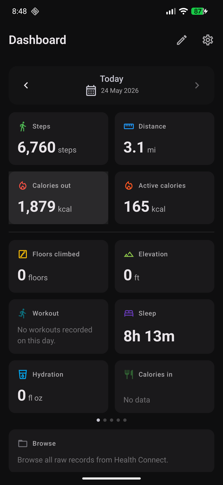
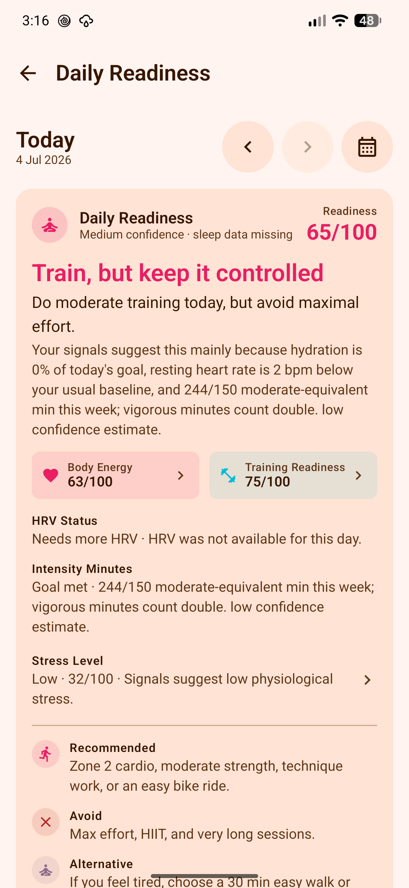

# OpenVitals

OpenVitals is a local-first Android app for viewing, logging, importing, and understanding health data from Health Connect.

It is for people who want a clear daily dashboard, focused metric detail screens, and explicit write/import flows without creating an account, uploading health data, or depending on an online service.

<figure markdown="1">
{ .app-screenshot }
<figcaption>Dashboard</figcaption>
</figure>

<figure markdown="1">
{ .app-screenshot }
<figcaption>Daily Readiness</figcaption>
</figure>

## Source Code

- Android app: [github.com/OpenVitals-MTU/android-app](https://github.com/OpenVitals-MTU/android-app)
- Documentation: [github.com/OpenVitals-MTU/docs](https://github.com/OpenVitals-MTU/docs)
- Translations: [translate.codeberg.org/projects/openvitals/mobile-app](https://translate.codeberg.org/projects/openvitals/mobile-app/)
